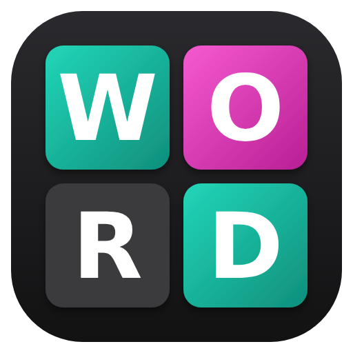
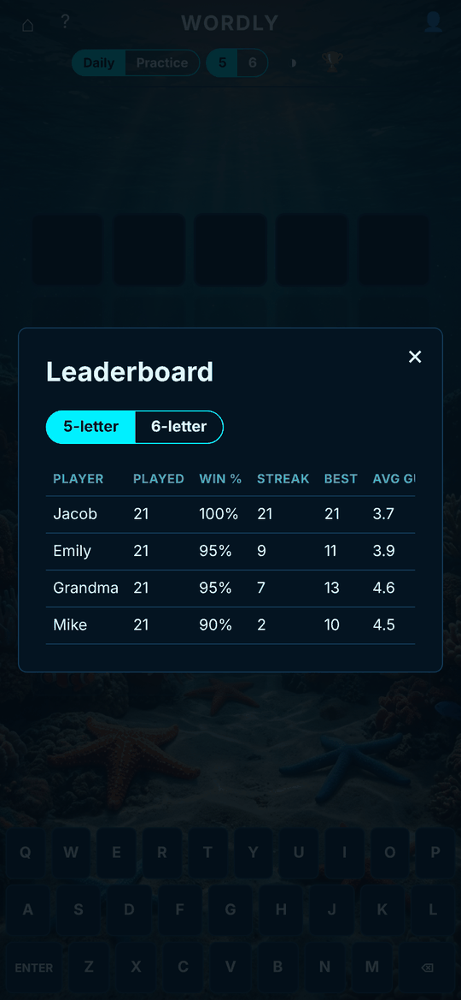
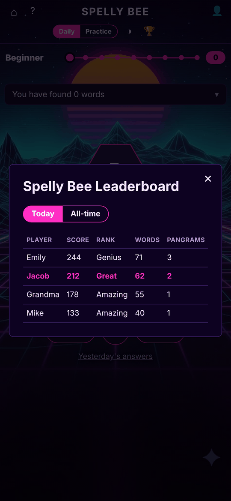
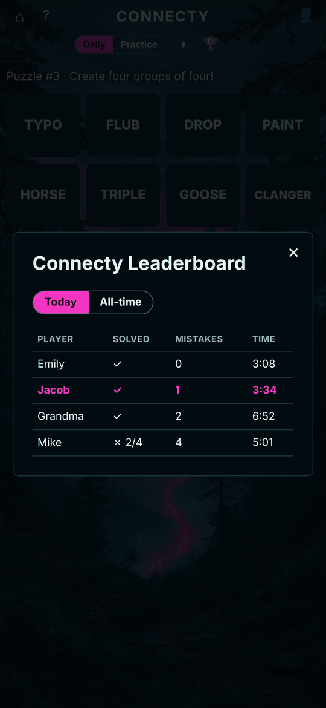
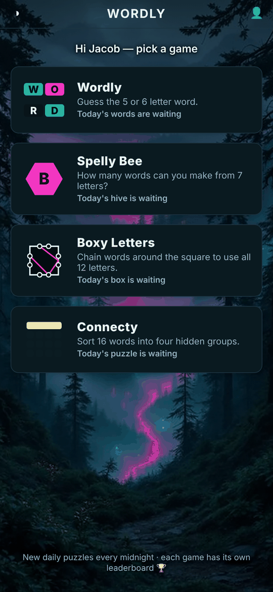
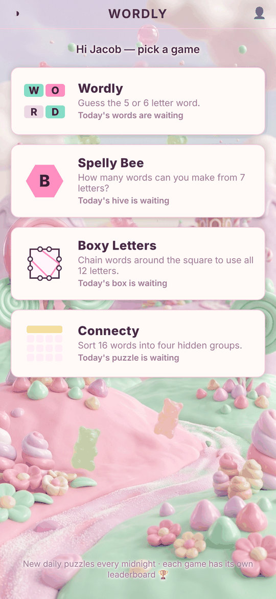
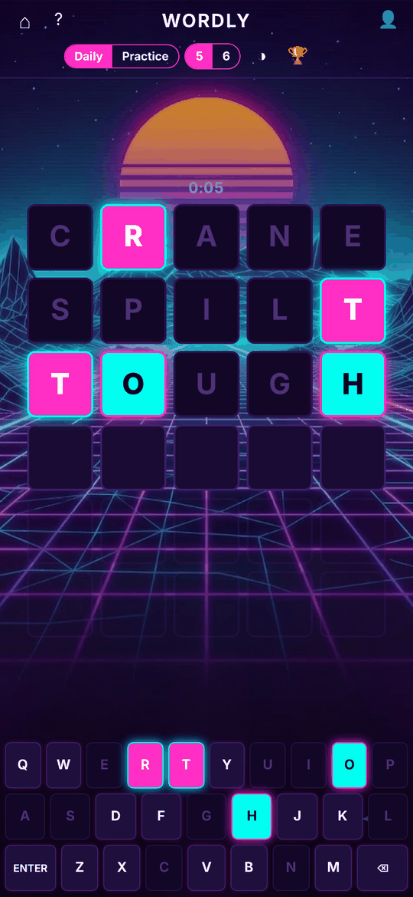
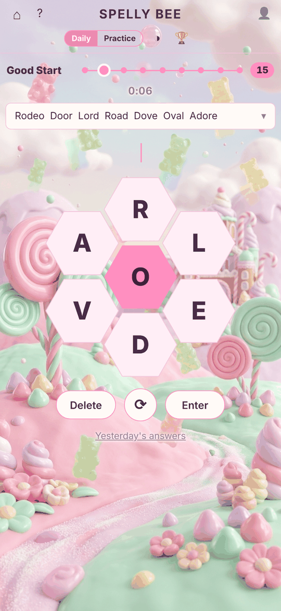
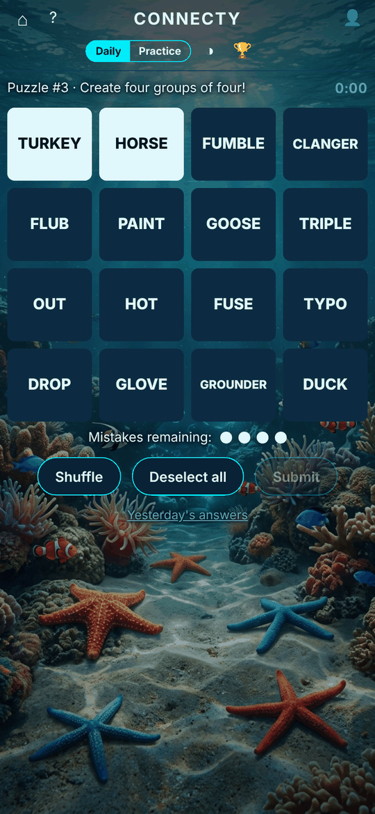

# Wordly



[](https://github.com/adam2893/wordly/actions/workflows/docker-publish.yml)
[](https://github.com/adam2893/wordly/pkgs/container/wordly)

**Docker image:** [`ghcr.io/adam2893/wordly:latest`](https://github.com/adam2893/wordly/pkgs/container/wordly) (`docker pull ghcr.io/adam2893/wordly:latest`)

A small, self-hosted collection of daily word and logic games: **Wordly** (guess the 5 or 6 letter word), **Spelly Bee**, **Boxy Letters**, **Connecty**, **Mini Crossy**, **Crossy**, **Tiley**, and **Sudoky**. Mobile-friendly, no accounts, shared leaderboards for everyone on your server, plus a **Daily Archive** (📅) to catch up on any past day you missed. The home page (`/`) is a game menu showing today's progress in each game, and every game shares the same themes, player name, and leaderboard backend.

## Play against your family and friends

The big difference from the NYT games: **everyone on your server plays the same daily puzzles and lands on the same leaderboard.** Challenge your spouse, kids, or friends, compare today's results, and see who's ahead over weeks of streaks, win rates, average guesses, and best times. Each game has its own board, with a **Today** view and an **All-time** view.

<p align="center">
  
  
  
</p>

Pick a name on any device and you're in; there are no accounts or sign-ups.

## Screenshots

A few of the themes: Forest, Bubblegum 3D, Synthwave and Ocean. Pick yours with the theme button (◑) on the home menu; it applies to every game.

<p align="center">
  
  
  
  
  
</p>

<sub>Leaderboard screenshots use sample players and scores.</sub>

## Games

### Wordly (`/wordly`)

- **5 or 6 letter mode** — toggle in the header, adjusts guess count (6 tries for 5-letter, 7 for 6-letter, word length + 1).
- **Daily Challenge** — everyone gets the same word each day (per length), computed deterministically from the date so it resets automatically at local midnight. No server round-trip needed to pick it.
- **Practice mode** — unlimited random-word games, doesn't touch the leaderboard.
- **Leaderboard** — games played, win %, current streak, best streak, average guesses, best time, and average luck, separately for 5- and 6-letter.
- **Speed timer** — starts on your first keystroke each Daily game, shown live above the board, recorded on completion, and tracked on the leaderboard as each player's best time.
- **Luck rating** — on a win, shows how many answer-pool words were still possible right before your winning guess. Solve it in few guesses despite a wide-open field and you'll score high on luck; narrow it down methodically and you'll score low ("All Skill"). Averaged per player on the leaderboard.
- A **huge valid-word dictionary** (8,645 five-letter / 15,232 six-letter words) so common guesses never get rejected, while the daily/practice *answer* always comes from a smaller curated common-word list (2,315 / 1,233 words) so the puzzle itself stays fair and guessable.

### Spelly Bee (`/bee`)

- Make words from a 7-letter hive; every word needs the center letter and at least 4 letters. Scoring: 1 point for 4-letter words, 1 per letter above that, +7 for a **pangram** (uses all 7 letters).
- Ranks from Beginner to **Genius** (70%) and **Queen Bee** (every word). Tap the rank bar for the thresholds.
- **Daily** hive shared by everyone (resets at midnight), re-rolled until it has 20–70 answers so no day is a dud; **Practice** for unlimited random hives, with a "Reveal answers" button.
- **Yesterday's answers**, with the words you found ticked off.
- **Time to Genius** — an active-play clock that pauses when the tab isn't visible.
- **Leaderboard**: *Today* (score, rank, words, pangrams, Genius time) and *All-time* (days played, average % of max, Genius days, Queen Bee days, pangrams, streak, best Genius time). Scores submit as you play (debounced).
- Keyboard: type letters, Enter, Backspace, Space to shuffle.

### Boxy Letters (`/boxed`)

- 12 letters, 3 per side of a square. Words chain end-to-start, consecutive letters must come from different sides, and the goal is to use all 12 letters in as few words as possible.
- Each daily box is generated around a real two-word solution from common words, so a 2-word solve is always possible. A **par** (4–6 words) is set based on how many 2-word solutions exist.
- Delete past the start of a word to reopen the previous one; Restart clears everything.
- **Daily** + **Practice** modes, **yesterday's solution**, and an active-play timer.
- **Leaderboard**: *Today* (words, par, time — fewer words wins, time breaks ties) and *All-time* (solves, average words, fewest words, 2-word solves, at/under-par solves, best time, streaks). First solve of the day counts.

### Connecty (`/connections`)

- 16 words, four hidden groups of four. Tap four words and Submit; four mistakes and you're out. "One away…" when three of the four belong together, and repeat guesses don't cost a mistake.
- Groups are color-coded by difficulty (yellow → green → blue → purple). Purple groups are wordplay: hidden words, fill-in-the-blank compounds (___BALL, FIRE___), anagrams, words that start or end with something.
- **Red herrings, but one answer**: words regularly fit a second group on the board, but every puzzle is checked at build time to have exactly one way to sort all 16 (see Dictionary below).
- **Daily** puzzle shared by everyone (numbered from #1 on 2026-11-02), **Practice** plays any puzzle from the archive, **Yesterday's answers**, active-play timer, and a copyable emoji result grid.
- **Leaderboard**: *Today* (solved, mistakes, time) and *All-time* (played, win %, perfect games, average mistakes, best time, streaks). First finished game of the day counts.

### Mini Crossy (`/mini`) & Crossy (`/crossword`)

- **Mini Crossy** is a bite-sized 5×5 daily crossword; **Crossy** is a full-sized daily crossword, both sourced from community puzzles on [Crosshare](https://crosshare.org) with constructor credit in the byline.
- Tap a square to select it, tap again (or tap the clue bar / press `Space`) to switch between **Across** and **Down**, and use `‹` / `›` (or `Tab` / `Enter`) to jump between clues. Desktop viewports also show side-by-side Across and Down clue lists.
- Optional **Check word**, **Reveal letter**, and **Reveal word** buttons if you get stuck — solving with 0 hints earns a **Flawless ★** badge on the leaderboard.
- **Daily** + **Practice** modes, **Yesterday's answers**, active-play timer, and a copyable emoji share grid for minis.
- **Leaderboard**: *Today* (time, hints — fewest hints wins, time breaks ties) and *All-time* (solved, flawless ★ solves, best time, average time, streaks). First solve of the day counts.

### Tiley (`/tiles`)

- Clear the 5×6 board of 30 layered pattern tiles (ported from [baldoalessandro/tiles_game](https://github.com/baldoalessandro/tiles_game)). Each tile holds up to 3 overlapping layers (outer shape, middle motif, inner center).
- Tap a tile, then tap a second tile that shares at least one matching layer — shared layers vanish from both tiles and your **Combo** increases by 1. When your active tile empties completely, you get a free hop to any tile on the board without breaking your combo.
- Clear all 30 tiles with 0 misses to achieve a **Perfect 45/45 ★** combo!
- **Daily** board and motif palette (Squircle Pebbles, Azulejo Diamonds, Bauhaus Rings, Origami Petals) shared by everyone, plus **Practice** mode, **Daily Archive** (📅), and active-play timer.
- **Leaderboard**: *Today* (best combo, misses, time) and *All-time* (boards cleared, perfect ★ games, average combo, best time, streaks).

### Sudoky (`/sudoku`)

- Daily & Practice **Easy**, **Medium**, and **Hard** 9×9 Sudoku puzzles (puzzle bank from [TN1ck/super-sudoku](https://github.com/TN1ck/super-sudoku), pre-solved via `tools/build_sudoku.py`).
- **Notes (Pencil marks)** mode (`N` key) for 1–9 candidate numbers inside empty cells — placing a digit automatically clears matching notes in the same row, column, and 3×3 box.
- Row/column/box peer highlighting, same-digit highlighting, real-time conflict highlighting, **Undo** (`U`), **Erase**, **Hint**, and remaining-count badges on each number button.
- **Leaderboard**: separate **Easy**, **Medium**, and **Hard** tabs with *Today* (time, mistakes, hints) and *All-time* (solved, flawless ★ solves, best time, average time, streaks).

### Shared

- **Daily Archive (📅)** — missed a day? Tap the calendar button in any game's header to browse and play the past 30 days of daily puzzles, complete with completion badges (`✓`, `✗`, `•••`) and leaderboard submission.
- **19 themes** — Dark, Light, Standard Neon, Neon City, Synthwave, Bubblegum 3D, Ocean, Sunset, Forest, Halloween, Christmas, Neon 80s, Spooky, Retro Terminal, Bubblegum, Art Deco, Tropical, Desert, Dessert — picked from the palette button on any page, saved across visits and games.
- **Player name** (no password) set once, used by every game's leaderboard.

## Architecture

Frontend is plain HTML/CSS/JS (`public/`), no build step, no framework. It's paired with a small zero-dependency Node backend (`server.js`, built-in `http`/`fs` only — no `npm install`, no `package.json`) that does two things:

1. Serves the static frontend (gzip-compressed for text assets, with clean URLs like `/bee` → `bee.html`).
2. Stores and aggregates leaderboard scores as JSON files in the data directory (`scores.json` for Wordly, `bee.json`, `boxed.json`, `connections.json`), so results submitted from any device/browser are visible to everyone.

Shared frontend code (themes, player name, modals, dates, seeded RNG, stopwatch) lives in `public/common.js`; each game has its own `*.html` + `*.js`, with Spelly Bee / Boxy Letters / Connecty styles in `public/games.css`.

### Rate limiting

The API is rate limited per client IP with fixed one-minute windows: **30 score submissions/minute** and **120 leaderboard reads/minute** by default (override with `RATE_LIMIT_WRITES` / `RATE_LIMIT_READS` env vars). Over the limit returns `429` with a `Retry-After` header; the games quietly retry later.

If you put the container behind a reverse proxy (Nginx Proxy Manager, SWAG, Traefik…), set `TRUST_PROXY=1` so limits key on the real client IP from `X-Forwarded-For` rather than the proxy's address. Leave it unset when clients connect directly, so nobody can spoof the header.

The daily word itself is **not** served by the backend — it's derived client-side from a deterministic hash of the local date, so it needs no network call and stays in sync across devices without any server coordination. (This does mean the word technically sits in the page's JS if someone opens dev tools — there's no server-side anti-cheat. Fine for a friendly household leaderboard; don't peek at `words.js` before you've guessed.)

Score submissions are trusted from the client (no server-side guess verification) — again, appropriate for a private 2-person leaderboard, not a public competitive one.

## Running it locally

You need Node.js (any reasonably recent version) to run the full app with the leaderboard:

```bash
node server.js
```

Visit `http://localhost` (or set `PORT`/`DATA_DIR` env vars, e.g. `PORT=5173 node server.js`).

To preview just the frontend without Node (leaderboard calls will fail gracefully, everything else works), serve `public/` with any static file server, e.g. the bundled zero-dependency PowerShell server for Windows machines without Python/Node:

```powershell
powershell -File .devserver/serve.ps1 -Port 5173
```

## Docker / Unraid

A `Dockerfile` (Node 20 alpine) and a GitHub Actions workflow ([`.github/workflows/docker-publish.yml`](.github/workflows/docker-publish.yml)) are included. Every push to `main` builds, smoke-tests, and publishes a multi-arch (`linux/amd64`, `linux/arm64`) image to [GitHub Container Registry](https://github.com/adam2893/wordly/pkgs/container/wordly) at:

```
ghcr.io/adam2893/wordly:latest
```

Quick run with Docker:

```bash
docker run -d --name wordly -p 8080:80 -v wordly-data:/data ghcr.io/adam2893/wordly:latest
```

To run it on Unraid:

1. **Docker tab → Add Container.**
2. **Repository**: `ghcr.io/adam2893/wordly:latest`
3. **Port**: map container port `80` to whatever host port you want (e.g. `8080`).
4. **Path**: map container path `/data` to a host appdata folder (e.g. `/mnt/user/appdata/wordly`) — **this is what makes the leaderboard persist** across container restarts/updates. Without it, scores reset every time the container is recreated.
5. Apply — Unraid pulls the image and starts it. Visit `http://<unraid-ip>:8080`.

If the GHCR package is private, Unraid needs a registry login first (Docker tab → gear icon → add a registry with a GitHub personal access token that has `read:packages` scope). Making the repo/package public avoids this.

To build and run locally instead (no GHCR):

```bash
docker build -t wordly .
docker run -p 8080:80 -v wordly-data:/data wordly
```

## Dictionary

Spelly Bee and Boxy Letters word lists (`public/words-bee.js`, `public/words-boxed.js`) are generated by `tools/build_words.py` from the ENABLE list, filtered by word frequency ([wordfreq](https://pypi.org/project/wordfreq/)) and an offensive-word blocklist:

- **Spelly Bee answers** (~21.8k) are modeled on the NYT's own list. Fan archives of past NYT puzzles ([tedmiston/spelling-bee-answers](https://github.com/tedmiston/spelling-bee-answers), [philshem/scrape_bee](https://github.com/philshem/scrape_bee), [bwillenbring/nytimes-bee](https://github.com/bwillenbring/nytimes-bee) — ~1,200 puzzles, 2019–2025) show which words the NYT accepted and, since every word that fit a puzzle but isn't in its answers was turned down, which it rejected. Each word takes its most recent NYT verdict (~9k accepted, ~6.5k rejected). Words the NYT has never judged fall back to our own list: common words ([wordfreq](https://pypi.org/project/wordfreq/)), well-known dictionary words ([SCOWL](http://wordlist.aspell.net/) size ≤55) and their inflections ([lemminflect](https://pypi.org/project/lemminflect/)). Backtested against a held-out year of NYT puzzles, this matches the NYT's answers to within ~0.4 extra and ~0.7 missing words per puzzle (the previous frequency-based list was off by ~5 extra and ~6.6 missing). No S, ever (same as NYT).
- **Hives** are still picked from `BEE_WORDS`, a stable common-word list, so changing what counts as an answer never reshuffles a daily puzzle.
- **Petitions**: `tools/bee-petitions.txt` — one word per line to accept a word regardless of the NYT's verdict (this also overrides the generic blocklists below), or `-word` to reject one. Re-run the build after editing.
- **Offensive words**: the LDNOOBW list plus hand-kept `EXTRA_BLOCK` / `LATE_BLOCK` sets (slurs and crude words it misses) are excluded from every answer/solution list — *except* that a Spelly Bee word the NYT itself has accepted (ANAL, NUDE, NIPPLE, CRAP, POOP…) counts as an answer anyway. Slurs and hate terms (`NEVER_ACCEPT`) stay out no matter what. Words blocked after launch go in `LATE_BLOCK`, which lists them in `BEE_AVOID` / `BOXED_AVOID` instead of removing them from the puzzle-picking lists, so blocking a word never reshuffles daily puzzles.
- **Boxy Letters valid words** (~131k): the full ENABLE list minus words with doubled letters (impossible to play). Solutions for generated puzzles come from a ~12k common-word subset.

Re-run with `pip install wordfreq lemminflect && python3 tools/build_words.py` (needs network access to GitHub and SourceForge; downloads are cached in `tools/.cache`).

Connecty (`public/words-connections.js`) is generated by `tools/build_connections.py` from the category bank in `tools/connections-categories.txt` (~200 categories, each with the words that can be shown plus extra words that also fit it):

- Each puzzle takes one category per difficulty and four words from each. It's only kept if the 16 words can be sorted into its four categories in **exactly one way**, and no other category in the bank covers four of the words (other than one of the puzzle's own groups), so there's never a second "correct" grouping. Wordplay categories carry a rule (`before:BALL`, `start:CAR CAB`, `contains:RED TAN`, `anagram:STEAL`…) that the checker also applies to every other word on the board — fill-in rules are checked against the ENABLE dictionary — so a stray SNOWMAN or hidden RED gets caught.
- Among valid candidates it prefers ones with red herrings, and doesn't reuse a category until most of its difficulty tier has had a turn.
- 1,000 puzzles are generated (~2¾ years of dailies, then it loops). Re-running the build **keeps existing puzzles** and only appends, so editing the bank never changes a puzzle someone has played; `--rebuild` starts over. Run `python3 tools/build_connections.py` (uses the same cached downloads as `build_words.py`).

Wordly:

- **Valid guesses** (`GUESSES[5]`, `GUESSES[6]` in `public/words.js`): a large Scrabble-style word-game dictionary (ENABLE word list), ~8.6k five-letter and ~15.2k six-letter words. This is what guesses are checked against, so legitimate everyday words are essentially never rejected.
- **Possible answers** (`ANSWERS[5]`, `ANSWERS[6]`): the curated common-word lists from the original build — a curated 2,314-word list of common words for 5 letters, and a manually-screened ~1,233-word list for 6 letters. Daily and Practice answers are always picked from here, so the puzzle stays solvable/fair. `ANSWERS` is a subset of `GUESSES`, guaranteed at build time.

## Customizing

- **Add a theme**: add a `[data-theme="yourname"]` block in `public/style.css` with the same CSS custom properties as the existing themes, then add `{ id, name, swatch }` to the `THEMES` array at the top of `public/common.js`. Optionally set `--bee-center` / `--bee-center-text` if the theme's `--color-present` doesn't stand out as the Spelly Bee center hex.
- **Add a length**: add `GUESSES[n]` and `ANSWERS[n]` arrays in `public/words.js`, a `<button class="len-btn" data-len="n">n</button>` in `index.html`'s `.length-toggle`, and the board/keyboard/daily logic handles the rest automatically (max guesses = length + 1).
- **Change the daily reset time or make it shared across timezones**: `todayDateString()` in `public/common.js` uses the browser's local date. Switch it to a fixed UTC-based string if you'd rather everyone share one global reset time regardless of timezone.

## Theme background images

`public/images/themes/` holds per-theme background images, wired up as a `background-image` on the matching `[data-theme="..."]` block in `public/style.css` (see the "Theme background images" section near the top of that file). Currently wired: Ocean, Christmas, Spooky, Bubblegum 3D, Sunset, Standard Neon, Neon City, Neon 80s, Synthwave, Forest, Halloween (Sunset, Forest and Halloween use user-supplied photos/art), Retro Terminal, Bubblegum, Art Deco, Tropical, Desert, Dessert. Dark and Light intentionally stay flat.

The Retro Terminal, Bubblegum, Art Deco, Tropical, Desert, and Dessert backgrounds are hand-built SVGs generated by `tools/make_theme_art.py` (seeded, so re-running reproduces them exactly) — edit the script and re-run to tweak them.

Convention:

- File name matches the theme's `id` from the `THEMES` array in `public/common.js` (e.g. `ocean.jpg`, `neon-city.svg`). Extension can be `.jpg`, `.png`, `.webp`, or `.svg`.
- Portrait-friendly / mobile-first framing, since the board is narrow and tall on phones. `background-position: center top` keeps the top of the image anchored under the header.
- Each wired theme pairs its image with a `linear-gradient(...)` scrim tuned to that image's brightness, layered in the same `background-image` declaration, so tiles/keys (which always paint a solid theme color) and header text stay legible on top.

To add one for a theme that doesn't have it yet: drop the image in this folder, then add its `[data-theme="..."] body { background-image: linear-gradient(...), url("images/themes/yourfile"); }` rule alongside the others, and add the theme's selector to the shared `background-size/position/repeat` rule above them.

## Unraid

Wordly is listed in Unraid's Community Applications (search for **Wordly** in the Apps tab). The template lives in [`templates/wordly.xml`](templates/wordly.xml).

## Versions

Every push to `main` publishes [`ghcr.io/adam2893/wordly:latest`](https://github.com/adam2893/wordly/pkgs/container/wordly). Release tags (`v1.0.0`, ...) also publish `:1.0.0` and `:1.0`, so you can pin a version.

## Credits

- Word data: [ENABLE](https://github.com/dolph/dictionary) (public domain), [wordfreq](https://github.com/rspeer/wordfreq), [SCOWL](http://wordlist.aspell.net/), [lemminflect](https://github.com/bjascob/LemmInflect), the [LDNOOBW](https://github.com/LDNOOBW/List-of-Dirty-Naughty-Obscene-and-Otherwise-Bad-Words) list, crossword puzzles from [Crosshare](https://crosshare.org), Tiles mechanics from [baldoalessandro/tiles_game](https://github.com/baldoalessandro/tiles_game), and Sudoku puzzles from [TN1ck/super-sudoku](https://github.com/TN1ck/super-sudoku).
- Several theme backgrounds are wallpapers collected from the web. If you own one of them and want it credited or removed, please [open an issue](https://github.com/jakeshake/wordly/issues) and it will be taken care of promptly.
- Wordly is an independent project and is not affiliated with or endorsed by The New York Times.

## License

[MIT](LICENSE)

If you enjoy Wordly, you can [buy me a coffee](https://buymeacoffee.com/jakeshake).
